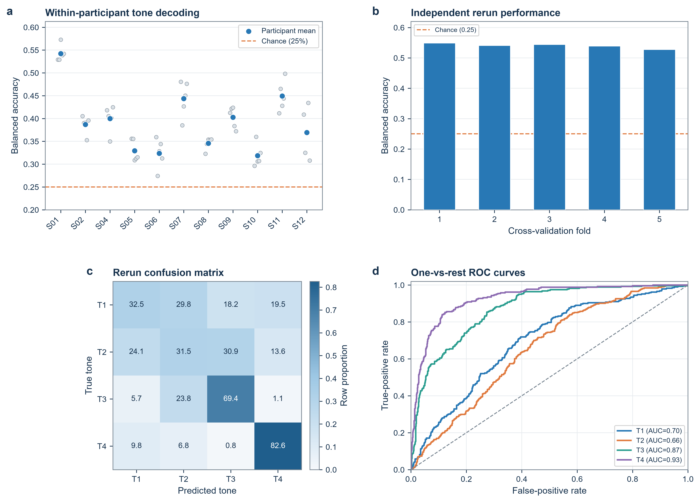
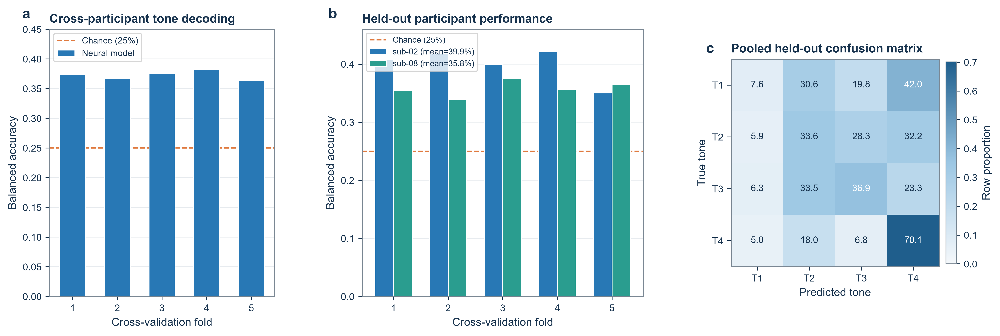

# Mandarin-sEEG analysis and decoding code

This repository contains reproducible analysis code for a controlled-access
Mandarin speech stereotactic EEG (sEEG) dataset. It provides four workflows:

1. single-channel time-frequency and high-gamma validation;
2. audio-sEEG acoustic-contamination screening based on the spectrotemporal
   strategy of Roussel et al. (2020);
3. within-participant four-class lexical-tone decoding; and
4. cross-participant decoding with held-out participants.

No participant recordings, speech audio, clinical information, electrode
coordinates, or trial-level annotations are included in this repository.

## Repository layout

```text
.
|-- src/mandarin_seeg_validation/
|   |-- time_frequency.py
|   `-- acoustic_contamination.py
|-- src/mandarin_seeg/            # decoding models and data pipeline
|-- configs/                      # within- and cross-participant settings
|-- scripts/                      # training, CV, and figure entry points
|-- docs/
|   |-- METHODS.md
|   |-- DATA_ACCESS_WORKFLOW.md
|   |-- DATA_USE_AGREEMENT_TEMPLATE.md
|   `-- decoding/
|       |-- DATA_INTERFACE.md
|       `-- MODEL_CARD.md
|-- examples/generated_figures/  # publication-style decoding examples
|-- tests/
|-- outputs/                      # ignored except for .gitkeep
|-- pyproject.toml
`-- requirements.txt
```

## Installation

Python 3.10 or later is recommended.

```bash
python -m venv .venv
# Windows: .venv\Scripts\activate
# Linux/macOS: source .venv/bin/activate
python -m pip install --upgrade pip
python -m pip install -e .
```

Install the optional PyTorch decoding stack when running the neural decoders:

```bash
python -m pip install -e ".[decoding]"
```

For development and smoke tests:

```bash
python -m pip install -e ".[decoding,dev]"
pytest
```

## Expected private dataset layout

All commands expect an authorized local copy of the controlled-access dataset
in the following BIDS-inspired structure:

```text
DATASET_ROOT/
  sub-XX/
    sub-XX_channels.tsv
    ses-YY/
      audio/
        *_audio.wav
      ieeg/
        *_ieeg.npy
      *_ieeg.json
      *_events.tsv
```

Neural NPY files are expected to contain a two-dimensional array organized as
`[time_samples, channels]`. Use `--time-axis 1` only for legacy arrays stored
as `[channels, time_samples]`.

## Time-frequency validation

The following example analyzes one channel from one trial. Channel indices are
zero based. Analysis windows must be specified from the task annotations rather
than inferred from the example below.

```bash
mandarin-seeg-time-frequency \
  --input /path/to/sub-XX_task-sentence_run-0001_ieeg.npy \
  --sfreq 2000 \
  --channel-index 39 \
  --channel-label E3 \
  --baseline 0.3 1.3 \
  --speech 1.61 4.88 \
  --output-dir outputs/time_frequency
```

The command produces preprocessing traces, a Welch power spectrum, a Morlet
time-frequency map, frequency-band time courses, a compressed numerical result,
and a JSON parameter summary.

## Acoustic-contamination screening

```bash
mandarin-seeg-acoustic-screen \
  --dataset-root /path/to/Mandarin_sEEG_BIDS \
  --output-dir outputs/acoustic_contamination \
  --max-trials 30 \
  --permutations 10000
```

Optional filters can limit a reproducibility check to selected records:

```bash
mandarin-seeg-acoustic-screen \
  --dataset-root /path/to/Mandarin_sEEG_BIDS \
  --participants sub-01,sub-02 \
  --sessions ses-01 \
  --output-dir outputs/acoustic_contamination_subset
```

The default parameters follow the primary analysis as closely as practical:
200 ms Hamming windows, spectrogram sampling at 50 Hz, raw PSD, audio centering
with a 1 s moving average, signed Pearson correlations over 75-1000 Hz, maximum
correlation across channels, and 10,000 row/column-shuffle permutations.

## Within-participant decoding

The within-participant benchmark predicts four Mandarin lexical-tone classes
using stimulus-grouped five-fold cross-validation. Preprocessing constructs a
0.5-40 Hz stream and a 70-150 Hz Hilbert-amplitude stream, normalizes the event
window to a fixed duration, and preserves variable electrode counts with a
Boolean channel mask.

Install the decoding dependencies, then run one fold:

```bash
python scripts/train_within_participant.py \
  --config configs/within_participant.yaml \
  --dataset-root /path/to/Mandarin_sEEG_BIDS \
  --subject sub-01 \
  --fold 0 \
  --output outputs/within_participant/sub-01/stag/fold-00
```

Run the configured cohort and folds sequentially:

```bash
python scripts/run_within_participant_cv.py \
  --config configs/within_participant.yaml \
  --dataset-root /path/to/Mandarin_sEEG_BIDS \
  --output-root outputs/within_participant
```

## Cross-participant decoding

The cross-participant benchmark trains on the development cohort and evaluates
zero-calibration transfer to the participants listed under
`split.heldout_subjects` in `configs/cross_participant.yaml`. The modular model
uses shared temporal encoding, permutation-equivariant electrode-set encoding,
dynamic channel pooling, phonological auxiliary heads, supervised contrastive
learning, and subject-domain regularization.

Run one fold:

```bash
python scripts/train_cross_participant.py \
  --config configs/cross_participant.yaml \
  --dataset-root /path/to/Mandarin_sEEG_BIDS \
  --fold 0 \
  --output outputs/cross_participant/heldout/fold-00
```

Run all configured folds:

```bash
python scripts/run_cross_participant_cv.py \
  --config configs/cross_participant.yaml \
  --dataset-root /path/to/Mandarin_sEEG_BIDS \
  --output-root outputs/cross_participant/heldout
```

Balanced accuracy is the primary metric because class support may differ. All
confusion matrices and ROC curves are generated from held-out predictions. See
[`docs/decoding/DATA_INTERFACE.md`](docs/decoding/DATA_INTERFACE.md) and
[`docs/decoding/MODEL_CARD.md`](docs/decoding/MODEL_CARD.md) for the complete
data contract, architectures, intended use, and limitations.

## Recreate decoding figures

```bash
python scripts/plot_within_participant_validation.py \
  --cohort-root outputs/within_participant \
  --rerun-root outputs/reproduction_sub01/sub-01/stag \
  --output figures/within_participant_validation

python scripts/plot_cross_participant_validation.py \
  --cross-root outputs/cross_participant/heldout \
  --output figures/cross_participant_validation
```

Reference PNG and editable SVG outputs are included in
`examples/generated_figures/`. Training outputs, checkpoints, predictions, and
path manifests are ignored by default because they may contain participant-level
results or local filesystem information.

### Example validation figures

The bundled figures summarize aggregate decoding results from the current
benchmark implementation and provide publication-layout examples. They do not
contain raw recordings or trial-level predictions.





## Controlled data access

The dataset is not downloaded through this code repository. Public metadata,
documentation, and code may be shared openly, while sEEG, speech audio, and
linked participant information remain under controlled access. See
[`docs/DATA_ACCESS_WORKFLOW.md`](docs/DATA_ACCESS_WORKFLOW.md) and the draft
[`docs/DATA_USE_AGREEMENT_TEMPLATE.md`](docs/DATA_USE_AGREEMENT_TEMPLATE.md).

The DUA is a template pending institutional approval. Repository maintainers
must replace all bracketed fields before accepting applications.

## Citation

When using the acoustic-contamination workflow, cite:

> Roussel P, Le Godais G, Bocquelet F, et al. Observation and assessment of
> acoustic contamination of electrophysiological brain signals during speech
> production and sound perception. *Journal of Neural Engineering*. 2020.
> <https://doi.org/10.1088/1741-2552/abb25e>

Please also cite the Mandarin-sEEG Data Descriptor and dataset DOI once they
are available.

## Licence and sensitive-data notice

The source code is released under the MIT License. The MIT License does not
apply to the controlled-access dataset or authorize access to participant data.
Do not open a GitHub issue containing raw signals, voice recordings, clinical
details, access credentials, or other restricted information.

